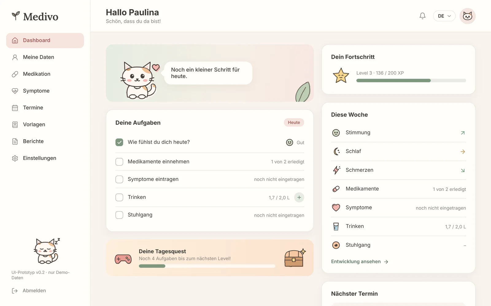

# Medivo

**Gesundheit, die sich deinem Alltag anpasst.**

Adaptive WebApp für Menschen mit chronischen Erkrankungen: Symptome, Medikamente und Termine dokumentieren, in einer Oberfläche, die sich an unterschiedliche Bedürfnisse anpasst.

### → [Live-Demo öffnen](https://paulina-codes.github.io/portfolio/medivo-demo/)

Läuft direkt im Browser, ohne Installation oder Anmeldung. Alle Daten sind fiktiv.



> **Status: frühe Entwicklungsphase.** Medivo ist ein Frontend-Prototyp ohne Backend und ohne Datenspeicherung. Oberfläche und Funktionsumfang können sich noch deutlich ändern, die Icons und Illustrationen werden voraussichtlich neu gezeichnet. Medivo ist kein Medizinprodukt und nicht für reale Gesundheitsdaten vorgesehen.

## Idee

Viele Menschen mit chronischen Erkrankungen sollen ihren Zustand regelmäßig dokumentieren, brechen das aber schnell ab. Medivo soll dabei motivieren und sich an die Person anpassen: Sieben Darstellungsmodi (z. B. Senioren, Minimal, Autismus) verändern Farben, Schriftgröße und Informationsdichte.

## Im Prototyp umgesetzt

- Täglicher Check-in zu Stimmung, Medikamenten, Symptomen, Trinkmenge und Verdauung
- Symptome mit Intensität, Medikamente mit Dosierung und Uhrzeit
- Vorlagen für häufige Erkrankungen, z. B. Migräne, Diabetes Typ 1, Rheuma
- Druckbare Arztzusammenfassung mit wählbarem Zeitraum
- Sieben Darstellungsmodi und Dark Mode, responsiv für Smartphone und Desktop

## Geplant

- Verläufe und Diagramme zu Symptomen und Einnahmen
- Backend mit Spring Boot und PostgreSQL, sichere Anmeldung
- Datenschutzkonzept mit Export- und Löschfunktion
- Mehrsprachige Oberfläche
- Usability-Tests mit verschiedenen Nutzergruppen

## Technik

React · TypeScript · Vite · Figma (Konzept)

<details>
<summary>Lokal starten (für Entwickler:innen)</summary>

Voraussetzung: Node.js (LTS)

```bash
npm install
npm run dev
```

</details>

## Kontakt

Paulina Kranewitter · [Portfolio](https://paulina-codes.github.io/portfolio/) · [paulina.kranewitter@web.de](mailto:paulina.kranewitter@web.de)
